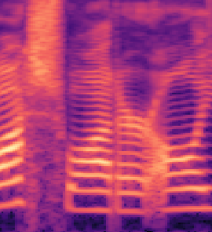
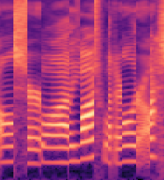
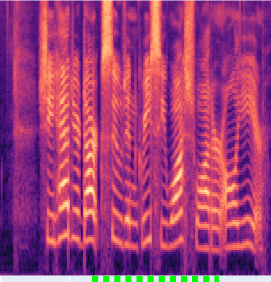
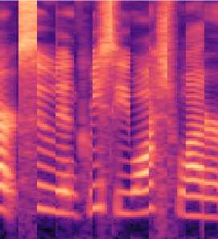
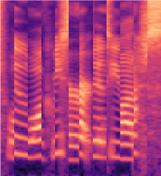
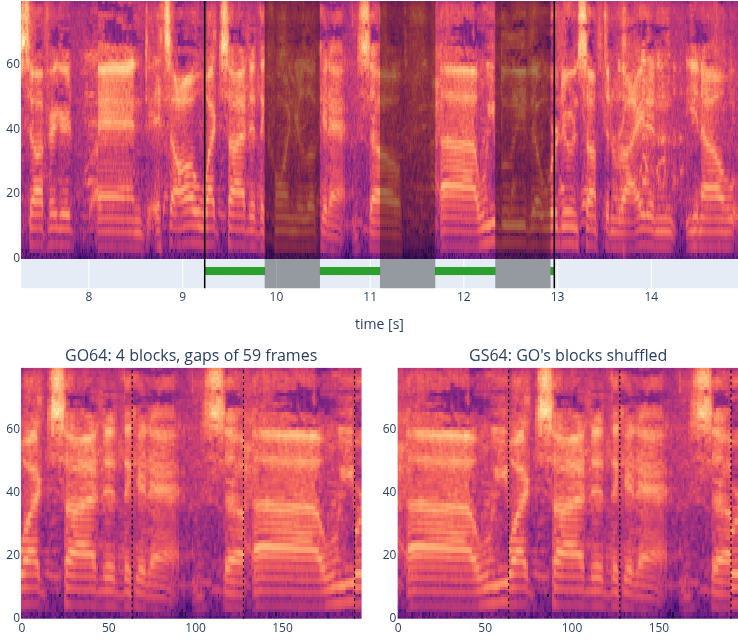
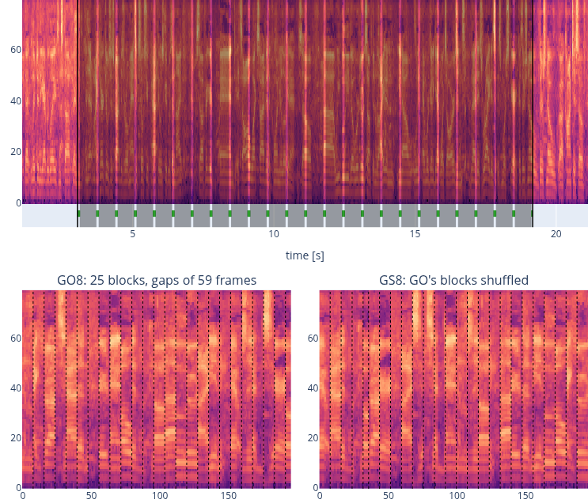
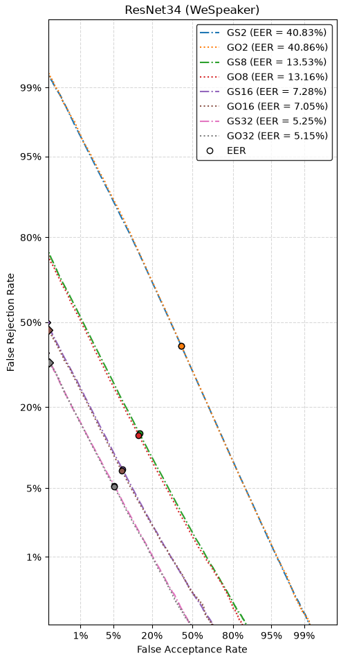
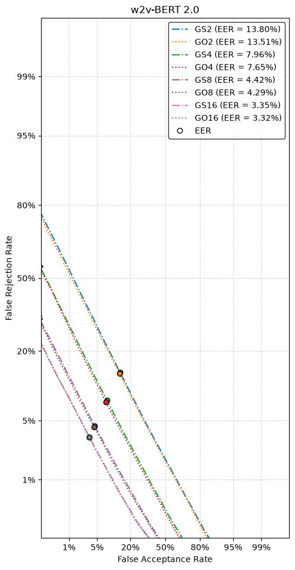

# Do neural networks make use of supra-segmental temporal information in speech?

_November 2026_

## Introduction

Back in 2009, Thilo Stadelmann and Bernd Freisleben showed that the absence of temporal information in speech
recordings made the task of matching a recording with its corresponding speaker impossible for humans. Complementarily, 
they showed that the presence of temporal information was _the_ distinguishing factor for humans to become
able to solve the task even under challenging conditions https://doi.org/10.1145/1631272.1631300.

About a decade later, Deep Neural Networks (DNNs) revolutionized speech recognition algorithms, but
they were still lacking human performance under challenging conditions.

This circumstance motivated Daniel Neururer and colleagues in 2022 to study whether DNNs exploit Supra-Segmental Temporal information
(SST; "information that is contained in the trajectory over many frames" @https://doi.org/10.1016/j.patrec.2024.03.016).
Surprisingly, they found that DNNs do not exploit such information, albeit their architectures would allow them to do so.

Instead, they showed that the tested neural networks exploit only Frame-Based[^fba] Acoustic information (FBA) for the speaker
identification task. Neururer et al. hypothesized that DNNs, despite architecturally capable, don't have to exploit
the more complex supra-segmental temporal information to achieve good results: The task was simply not challenging
enough for them, so they got away with a shortcut. Neururer et al. coined this behavior of neural networks as "Deep Cheating".

[^fba]: A frame is a short segment of audio, typically 10-30ms.

## Problem

Today, State Of The Art (SOTA) speech models have way more parameters and are trained on millions of hours of audio
recordings using a wide range of datasets as well as an array of data augmentation techniques. That said, these models had to cope
with much more variation during training in the hope that they generalize better to unseen data, including recordings
under challenging conditions. This bears the question, if the findings from Neururer et al. are still valid.

The original experiment conducted by the authors of Neururer et al. would require us to re-train each model
on shuffled audio data. Due to the bigger size of SOTA models and the large amount of data they are trained on, this
is not only a challenging task, but also an expensive one.

:::{table} [ResNet34](https://huggingface.co/Wespeaker/wespeaker-voxceleb-resnet34-LM) and [w2v-BERT 2.0](https://huggingface.co/facebook/w2v-bert-2.0) are two examples of speech models available in 2026.

|                      | Number of parameters |   Training data   |
|:---------------------|:--------------------:|:-----------------:|
| ResNet34 (WeSpeaker) |     317 million      |    2'442 hours    |
| w2v-BERT 2.0         |     600 million      | 4.5 million hours |
:::

With that said, we'll present a variation of the original experiment in this writeup, which allows determining
whether a model makes use of temporal information – without the need of re-training.

## Method

The core idea of the original experiment is straightforward: Neururer et al. compared the models' performance based on original and on shuffled
blocks of audio. If the model performs equally well on both, then it does not exploit information spanning across block
boundaries (@mfcc)

::::{figure}
:label: mfcc

:::{figure}
:class: grid grid-cols-2 items-end gap-4
(mfcc-original)=

(mfcc-shuffled)=

:::

Two representations of the same audio recording using [Mel Frequency Cepstrum Coefficients (MFCC)](https://en.wikipedia.org/wiki/Mel-frequency_cepstrum).
::::

This experimental setup works well if the same architecture is trained from scratch twice (once for each input regime).
However, it doesn't give us the desired answer without re-training: If we naively compare the performance of the original vs. the shuffled input
using a model which has only ever seen original data, its prediction error will be confounded by the simple fact that
the model has never seen the shuffled input before (ouf-of-distribution error). Because the prediction error is confounded,
we cannot say anything about the role played by the removed temporal information.

Therefore, we took a closer look at the differences between the original and the shuffled data:
@{mfcc} shows that shuffling causes discontinuities at the block boundaries.
To compensate for those in for the original ordered input, we need to simulate the discontinuities. This will allow us to
provide the same amount of consecutive information per speaker to the model for both input regimes and serves as a sanity
check whether the model is trying to integrate temporal information across block boundaries – or if it strictly uses
block local information.

To achieve this, we introduce gaps between the selected blocks in the original audio signal (@mfcc-gapped-blocks), and we
make sure that the newly added discontinuities in the original-ordered input are similar to the ones of the shuffled input.

::::{figure}
:label: mfcc-gapped-blocks

:::{figure}
:class: grid grid-cols-3 items-end gap-4
(mfcc-gapped-block-selection)=

(mfcc-gapped-block-original)=

(mfcc-gapped-block-shuffled)=

:::

Selecting blocks of fixed width in the original input and re-assembling them once in original and once in randomized order.
::::

As mentioned, to attribute the change in model performance to missing temporal information, the discontinuities in the originally
ordered input have to be similar to the ones of the shuffled input. We ensure this by choosing a gap width between the blocks,
which yields a similar join distance distribution (overlap $\ge 98 \%$) for both input regimes (@gap-joint-distribution).

:::{figure} ../.gitbook/assets/sst-fba-gap-joint-distribution.png
:label: gap-joint-distribution

Block join distance distributions for one specific block width (~ 80ms) and different gap widths of the original (GO) and shuffled (GS) blocks using VoxCeleb1-H dataset.
:::

At this point it's worth mentioning that these join distance distributions depend on the dataset ([VoxCeleb1-H](https://www.robots.ox.ac.uk/~vgg/data/voxceleb/) in our case),
the **gap width** _and_ the **block width**.

As we want to measure an approximate lower bound for the amount of temporal information
exploited, we have to make sure that the join distance distributions are not only similar within one block size, but also
across evaluated block sizes. So we did the same measurement across the evaluated block sizes, which yielded a required minimal gap width of 
590ms (@gap-join-dist-similarities).

:::{figure} ../.gitbook/assets/sst-fba-join-dist-similarities.png
:label: gap-join-dist-similarities

The convergence of join distance distributions across the evaluated block widths determines the required minimal gap
to be used in our experiment.
:::

Notice that, linguistically speaking, 590ms is quite a large gap (@speech-temporal-building-blocks). That's why we don't expect the
model to integrate meaningful temporal information across the gaps. Instead, we expect the blocks to be roughly independent. Therefore, the block
width gives us an indication for the temporal information the model pays attention to.

:::{figure} ../.gitbook/assets/speech-temporal-building-blocks.png
:label: speech-temporal-building-blocks

Approximate durations of the temporal building blocks in speech.
:::

In other words: If the findings of @https://doi.org/10.1016/j.patrec.2024.03.016 are still valid today, we'd expect the Equal Error Rate (EER)
for all supra-segmental blocks[^supra-segmental-blocks] to be equal. On the other hand, an increase in EER
due to a decrease in block width indicates that the model tries to integrate more temporal information than available within one block
(@mfcc-fixed-gap-blocks).

::::{figure}
:label: mfcc-fixed-gap-blocks

:::{figure}
:class: grid grid-cols-2 items-end gap-4

(mfcc-gapped-block-64)=

(mfcc-gapped-block-8)=

:::

Complete experiment: Fixed gaps across different block widths, evaluated in original and shuffled order.
::::

[^supra-segmental-blocks]: Blocks longer than one phoneme (i.e. longer than 150 ms; a phoneme is a synonym for a segment)

## Results

The results show that each models' performance depends on the block width: The more consecutive
information is available, the higher the models performance (@model-det-results) [^model-perf].

Our expectation that the blocks are independent is confirmed: Comparing the originally ordered (GO) and shuffled (GS) conditions,
the DET curves and EERs for equal block widths are very similar (@model-det-results).

[^model-perf]: A higher performance is indicated by a smaller area under the Detection Error Rate (DET) curve
               and consequently by a smaller Equal Error Rate (EER).

::::{figure}
:label: model-det-results

:::{figure}
:class: grid grid-cols-2 items-end gap-4

(model-det-resnet34)=

(model-det-w2vbert2)=

:::

Experiment results for ResNet34 (WeSpeaker) and w2v-BERT 2.0. GO: Original order, GS: Shuffled order. The numbers
indicate the corresponding block width in frames of each model.
::::

As we confirmed the plausibility of the results, we are now ready to shift our attention to whether these models exploit
supra-segmental temporal information. To answer this question, we mapped the block widths of the
evaluated models from the number of frames to their covering timespan in ms (@tbl-block-widths-in-time).

:::{table} Block widths in frames for a specific model and their covered timespan in ms.
:label: tbl-block-widths-in-time
:align: center

| Block width (in frames) | ResNet34 (WeSpeaker) | w2v-BERT 2.0 | 
|-------------------------|----------------------|--------------|
| 2                       | 20 ms                | 40 ms        |
| 4                       | 40 ms                | 80 ms        |
| 8                       | 80 ms                | **160 ms**   |
| 16                      | **160 ms**           | 320 ms       |
| 32                      | 320 ms               | 640 ms       |
:::

Based on this mapping, our focus of interest lies on block sizes at around 150 ms
(the approximate duration of one phoneme): In case the model has no use for SST information, then the EER should remain
constant as we are approaching this boundary from above. Otherwise, we conclude that the model is, at least to some extent,
trying to exploit SST information.

The **ResNet34** performs best at the biggest tested block size of 32 frames, which is equivalent to 320 ms.
Compared to a block size at 16 frames (160 ms) the resulting EER is at least $25.5 \%$ better [^resnet34-eer]. This
hints at the ResNet34 trying to exploit information which lasts longer than a single phoneme
($\approx$ 150 ms). Furthermore, we can observe that the model uses more than
just Frame-Based Acoustic (FBA) information for its task: It collapses for tiny block
widths, and its EER ends up being not much better than a random guess, if there are only 2 frames or 20 ms of
consecutive information left to look at.

Similarly, the **w2v-BERT 2.0** model performs best at its biggest tested block size of 16 frames - which is this model's
equivalent of 320 ms. Again, we see an increase of the resulting EER as we decrease the block widths. Comparing the
resulting EERs for this model at the verge of individual phonemes (block sizes of 160 ms vs. 320 ms) yields an EER for the
longer block width, which is at least $21.9 \%$[^w2v-bert-2.0-eer] better.

[^resnet34-eer]: Minimal observed EER improvement for ResNet34: \
                 $1 - EER(GS32) / EER(GO16) = 1 - 5.25 / 7.05 \approx 25.5 \%$
[^w2v-bert-2.0-eer]: Minimal observed EER improvement for w2v-BERT 2.0: \
                     $1 - EER(GS16) / EER(GO8) = 1 - 3.35 / 4.29 \approx 21.9 \%$

## Conclusions

We observed, that the models performance gradually declines as less and less temporal information is made available for them.
That said, even though FBA and segmental information are useful in a speaker verification task, they cannot cope for
the loss of supra-segmental temporal information.

Based on these results, we conclude that SOTA models indeed make use of supra-segmental information and that SST,
if available in addition to FBA, significantly improves their performance.
