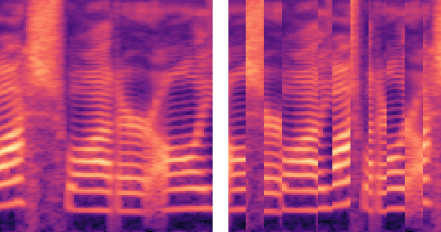
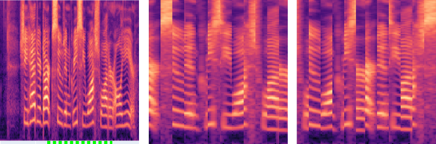
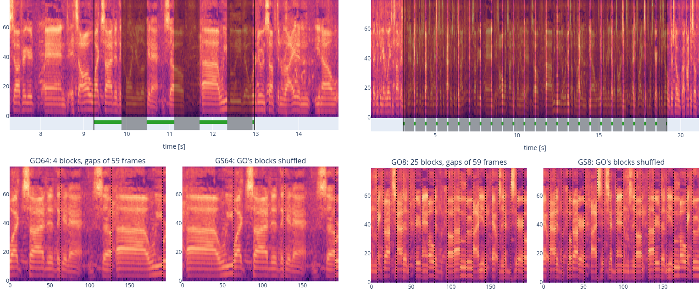
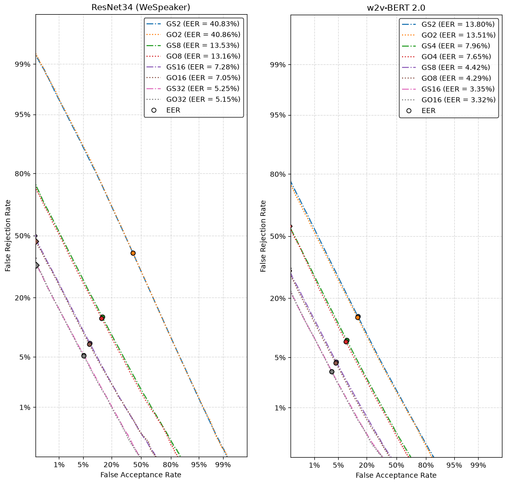

# Do neural networks make use of supra-segmental temporal information in speech?

## Introduction

Back in 2009, Thilo Stadelmann and Bernd Freisleben showed that the absence of temporal information in speech
recordings made the task of matching a recording with its corresponding speaker impossible for humans. Complementarily, 
they showed that the presence of temporal information was _the_ distinguishing factor for humans to become
able to solve the task even under challenging conditions https://doi.org/10.1145/1631272.1631300.

About a decade later, Deep Neural Networks (DNNs) revolutionized speech recognition algorithms but were
still lacking human performance under challenging conditions.

This circumstance motivated Daniel Neururer and colleagues in 2022 to study whether DNNs exploit Supra-Segmental Temporal information
(SST; "information that is contained in the trajectory over many frames" @https://doi.org/10.1016/j.patrec.2024.03.016).
Surprisingly, they found that DNNs do not exploit such information, albeit their architecture allows them to do so.

Instead, Neururer et al. showed that the tested neural networks exploit only Frame-Based[^fba] Acoustic information (FBA)
to solve a speaker identification task. The authors hypothesized that DNNs, despite architecturally capable, don't have
to exploit the more complex supra-segmental temporal information to achieve good results: The task was simply not challenging
enough for them, so they got away with a shortcut. This behavior of artificial neural networks was coined "Deep Cheating".

[^fba]: A frame is a short segment of audio, typically 10 - 30ms.

## Problem

Today, State Of The Art (SOTA) speech models have way more parameters and are trained on millions of hours of audio
recordings using a wide range of datasets as well as a wide array of data augmentation techniques. That said, these
models had to cope with much more variation during training in the hope that they generalize better to unseen data,
including recordings under challenging conditions. This bears the question, if the findings from Neururer et al. are still valid.

The original experiment conducted would require us to re-train each model
on shuffled audio data. Due to the bigger size of SOTA models and the large amount of data they are trained on, this
is not only a challenging task, but also an expensive one.

:::{table} [ResNet34](https://huggingface.co/Wespeaker/wespeaker-voxceleb-resnet34-LM) and [w2v-BERT 2.0](https://huggingface.co/facebook/w2v-bert-2.0) are two speech models available in 2026.

|                      | Number of parameters |   Training data   |
|:---------------------|:--------------------:|:-----------------:|
| ResNet34 (WeSpeaker) |     317 million      |    2'442 hours    |
| w2v-BERT 2.0         |     600 million      | 4.5 million hours |
:::

That said, we'll present a variation of the original experiment in this article, which allows determining
whether a model makes use of temporal information without the need of re-training.

## Method

The core idea of the original experiment is straightforward: Neururer et al. compared the models' performance based on original and on shuffled
blocks of audio. If the model performs equally well on both, then it does not exploit information spanning across block
boundaries (@mfcc)

::::{figure}
:label: mfcc

Two representations of the same audio recording using [Mel Frequency Cepstrum Coefficients (MFCC)](https://en.wikipedia.org/wiki/Mel-frequency_cepstrum).
_Left:_ All blocks are at their original position. _Right:_ The individual blocks are positioned randomly in time (x-axis).
::::

This experimental setup works well if the same architecture is trained from scratch twice (once for each input regime).
However, it doesn't give us the desired answer without re-training: If we naively compare the performance of the original vs. the shuffled input
using a model which has only ever been trained original data, its prediction error will be confounded by the simple fact that
the model has never seen the shuffled input before (ouf-of-distribution error). Therefore, we cannot say anything about the role played
by the removed temporal information.

@{mfcc} shows that shuffling causes discontinuities at the block boundaries.
To compensate for those in for the original ordered input, we need to add these discontinuities there as well. Such an augmentation
allows us to get rid of the confounding factor related to discontinuities in the shuffled input. To introduce these discontinuities,
we introduce gaps between blocks of the original audio signal (@mfcc-gapped-blocks). The gap width is chosen, such that the
resulting discontinuity distribution is similar to the discontinuity distribution of the shuffled input.

::::{figure}
:label: mfcc-gapped-blocks

Selecting blocks of fixed width in the original input and re-assembling them once in original and once in randomized order.
_Left:_ Selected blocks in green with a gap in between. _Middle:_ Selected (green) blocks in original order.
_Right:_ Selected (green) blocks in random order.
::::

We ensure similarity of the join discontinuities by choosing a gap with a similar join distance distribution 
(overlap $\ge 98 \%$) for both, original and shuffled inputs (@gap-joint-distribution).

:::{figure} ../.gitbook/assets/sst-fba-gap-joint-distribution.png
:label: gap-joint-distribution

Block join distance distributions for one specific block width (~ 80ms) and different gap widths of the original (GO) and shuffled (GS) blocks using VoxCeleb1-H dataset.
:::

At this point it's worth mentioning that these join distance distributions depend on the dataset ([VoxCeleb1-H](https://www.robots.ox.ac.uk/~vgg/data/voxceleb/) in our case),
the **gap width** _and_ the **block width**.

Therefore, make sure that the join distance distributions are not only similar within one block width, but
across all evaluated block widths. So we did the same measurement across all evaluated block sizes, which yielded
a required minimal gap width of 590ms (@gap-join-dist-similarities).

:::{figure} ../.gitbook/assets/sst-fba-join-dist-similarities.png
:label: gap-join-dist-similarities

The convergence of join distance distributions across the evaluated block widths determines the required minimal gap
to be used in our experiment.
:::

Linguistically speaking, 590ms is quite a large time span (@speech-temporal-building-blocks). That's why we don't expect the
model to integrate meaningful temporal information across the gaps. Instead, we expect the blocks to be roughly independent.

:::{figure} ../.gitbook/assets/speech-temporal-building-blocks.png
:label: speech-temporal-building-blocks

Approximate durations of the temporal building blocks in speech.
:::

The independence implies that the block width gives us a rough indication of the temporal information the model exploits:
If the findings of @https://doi.org/10.1016/j.patrec.2024.03.016 are still valid today, we'd expect the Equal Error Rate (EER)
for all supra-segmental blocks[^supra-segmental-blocks] to be equal. On the other hand, an increase in EER
due to a decrease in block width indicates that the model tries to exploit temporal information beyond a single block
and fails to do so (@mfcc-fixed-gap-blocks).

[^supra-segmental-blocks]: Blocks longer than one phoneme (i.e. longer than 150 ms; a phoneme is a synonym for a segment)

::::{figure}
:label: mfcc-fixed-gap-blocks

Our experiment in a nutshell: Fixed gaps across different block widths, evaluated in original and shuffled order.
_Left:_ Selection of 64 frame wide blocks. _Right:_ Selection of 8 frame wide blocks.
Within each panel, the bottom left shows the selected blocks in original order and the bottom right the same blocks in shuffled order.
::::

### Preparing the Dataset

Before we evaluate the SST exploitation of the [ResNet34](https://huggingface.co/Wespeaker/wespeaker-voxceleb-resnet34-LM) and [w2v-BERT 2.0](https://huggingface.co/facebook/w2v-bert-2.0) models on the
[VoxCeleb1-H](https://www.robots.ox.ac.uk/~vgg/data/voxceleb/) dataset, there is one important precondition of our experiment that we'll need to take care of:
We have to provide the same total amount of FBA information per speaker to the model, independently of the
block size. Otherwise, the model might perform worse on smaller blocks simply because it has less information available.

But for any fixed length information window $l_w$, decreasing
the block width $l_b$ means the total number of blocks $n_b$ increases and so does the total number of gaps $n_g$
@eq-total-number-of-blocks-and-gaps.

:::{math}
:label: eq-total-number-of-blocks-and-gaps
\begin{aligned}
n_b &= l_w / l_b \\
n_g &= n_b - 1
\end{aligned}
:::

An increasing total number of gaps $n_g$ has two side effects:

1. The total length of required audio $l_a$ grows proportionally with the number of gaps $n_g$,
   due to the fixed gap length $l_g$ (for a visualization, see @mfcc-fixed-gap-blocks):

:::{math}
:label: eq-total-length-of-audio

l_a  = l_w + l_g \cdot n_g
:::

2. The total number of joins grows as blocks get smaller - preventing us from directly comparing 
   the models' performance between different block sizes.

#### Augmentation for required audio length

In our experiment, the smallest block is $l_b = 20ms$ and we are using a fixed window of $l_w = 1.96 s$.
In our measurements (@gap-join-dist-similarities), we found a gap length of $l_g = 590 ms$ to suit our requirements.
Therefore, our experiment requires $l_a = 59.19s$ of audio per speaker.

Unfortunately, out of the $137'924$ utterances in VoxCeleb1-H approximately $99.97 \%$ are shorter than $59.19s$.
Only 46 utterances would be long enough for our experiment (@vox1-h-length-dist).

:::{figure} ../.gitbook/assets/sst-vox1-h-utterance-length-dist.png
:label: vox1-h-length-dist

Utterance length distribution of VoxCeleb1-H
:::

The good news is that in the VoxCeleb1-H dataset, the utterances are segments of YouTube videos. This
allows us to extend each utterance of the trial list with the audio around it: we append all other
utterances of the same speaker and video, in file name order. Every utterance therefore keeps its
place in the trial list, but now comes with up to several minutes of audio from the same speaker and
session. The number of utterances stays the same ($137'924$), while the median length grows from $6.5s$ to $92.9s$
(@vox1-h-joined-length-dist).

:::{figure} ../.gitbook/assets/sst-vox1-h-joined-utterance-length-dist.png
:label: vox1-h-joined-length-dist

Joined utterance length distribution of VoxCeleb1-H
:::

Of all extended utterances, $90'962$ or $65.95 \%$ now provide the required minimal length of $59.19s$.
Since every trial compares two utterances, a trial is only usable if both of its extended
utterances are long enough. In addition, those utterances must come from different videos: their
extended utterances would otherwise consist of the same audio, which would make the trial trivial.

This leaves us with $218'289$ of the $550'894$ VoxCeleb1-H trials ($99'121$ target and $119'168$
non-target trials), covering $90'438$ utterances of $1'178$ out of $1'190$ speakers. To keep the
results comparable across block widths, we evaluate all of them on this same set of trials.

#### Adjustment for increasing number of block joins

Equation @eq-total-number-of-blocks-and-gaps leaves us with a dilemma: we cannot keep both the
amount of FBA information and the number of joins constant across block widths. We therefore address
the joins in two complementary ways:

First, within each block width, the originally ordered (GO) and shuffled (GS) inputs consist of
exactly the same blocks. Hence, they contain the same number of joins and join discontinuities of the same
distribution thanks to the gap of at least $590 ms$ (@gap-join-dist-similarities). Any difference between
GO and GS at a given block width can therefore not be attributed to the joins.

Second, to compare across block widths, we add a control condition with a fixed number of blocks: $8$ 
blocks of width $l_b$ each, i.e. $7$ joins regardless of the block width. If the EER still increases with
decreasing block width under this condition, the increase is caused by the shorter blocks, not by
the larger number of joins.

## Results for two SOTA models

The results show that each models' performance depends on the block width: The more consecutive
information is available, the higher the models performance (@model-det-results) [^model-perf].

Our expectation that the blocks are independent is confirmed: Comparing the originally ordered (GO) and shuffled (GS) conditions,
the DET curves and EERs for equal block widths are very similar (@model-det-results).

[^model-perf]: A higher performance is indicated by a smaller area under the Detection Error Rate (DET) curve
               and consequently by a smaller Equal Error Rate (EER).

::::{figure}
:label: model-det-results

Experiment results for ResNet34 (WeSpeaker, _left_) and w2v-BERT 2.0 (_right_): DET curves with EER points of different block sizes. GO: Original order, GS: Shuffled order. The numbers
indicate the corresponding block width in frames of each model.
::::

As we confirmed the plausibility of the results, we are now ready to shift our attention to whether these models exploit
supra-segmental temporal information. To answer this question, we mapped the block widths of the
evaluated models from the number of frames to their covering timespan in ms (@tbl-block-widths-in-time).

:::{table} Block widths in frames for a specific model and their covered timespan in ms.
:label: tbl-block-widths-in-time
:align: center

| Block width (in frames) | ResNet34 (WeSpeaker) | w2v-BERT 2.0 | 
|-------------------------|----------------------|--------------|
| 2                       | 20 ms                | 40 ms        |
| 4                       | 40 ms                | 80 ms        |
| 8                       | 80 ms                | **160 ms**   |
| 16                      | **160 ms**           | 320 ms       |
| 32                      | 320 ms               | 640 ms       |
:::

Based on this mapping, our focus of interest lies on block sizes at around 150 ms
(the approximate duration of one phoneme): In case the model has no use for SST information, then the EER should remain
constant as we are approaching this boundary from above. Otherwise, we conclude that the model is, at least to some extent,
trying to exploit SST information.

The **ResNet34** performs best at the biggest tested block size of 32 frames, which is equivalent to 320 ms.
Compared to a block size at 16 frames (160 ms) the resulting EER is at least $25.5 \%$ better [^resnet34-eer]. This
hints at the ResNet34 trying to exploit information which lasts longer than a single phoneme
($\approx$ 150 ms). Furthermore, we can observe that the model uses more than
just Frame-Based Acoustic (FBA) information for its task: It collapses for tiny block
widths, and its EER ends up being not much better than a random guess, if there are only 2 frames or 20 ms of
consecutive information left to look at.

Similarly, the **w2v-BERT 2.0** model performs best at its biggest tested block size of 16 frames - which is this model's
equivalent of 320 ms. Again, we see an increase of the resulting EER as we decrease the block widths. Comparing the
resulting EERs for this model at the verge of individual phonemes (block sizes of 160 ms vs. 320 ms) yields an EER for the
longer block width, which is at least $21.9 \%$[^w2v-bert-2.0-eer] better.

[^resnet34-eer]: Minimal observed EER improvement for ResNet34: \
                 $1 - EER(GS32) / EER(GO16) = 1 - 5.25 / 7.05 \approx 25.5 \%$
[^w2v-bert-2.0-eer]: Minimal observed EER improvement for w2v-BERT 2.0: \
                     $1 - EER(GS16) / EER(GO8) = 1 - 3.35 / 4.29 \approx 21.9 \%$

## Comparison with Neururer et al.

To confirm the 
For comparison, we run the same experiment as above for the models used in @https://doi.org/10.1016/j.patrec.2024.03.016:

@neururer-models-det-results shows the results for these models.

:::{figure} ../.gitbook/assets/sst-neururer-models.png
:label: neururer-models-det-results

DET curves and EERs for the models used in @https://doi.org/10.1016/j.patrec.2024.03.016.
:::

## Conclusions

We observed, that the models performance gradually declines as less and less temporal information is made available for them.
That said, even though FBA and segmental information are useful in a speaker verification task, they cannot cope for
the loss of supra-segmental temporal information.

Based on these results, we conclude that SOTA models indeed make use of supra-segmental information and that SST,
if available in addition to FBA, significantly improves their performance.
